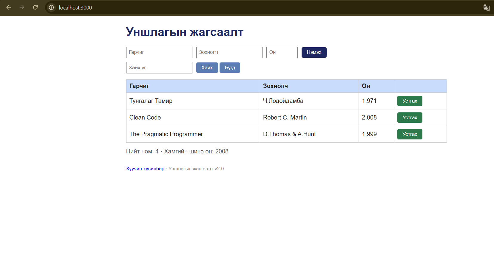
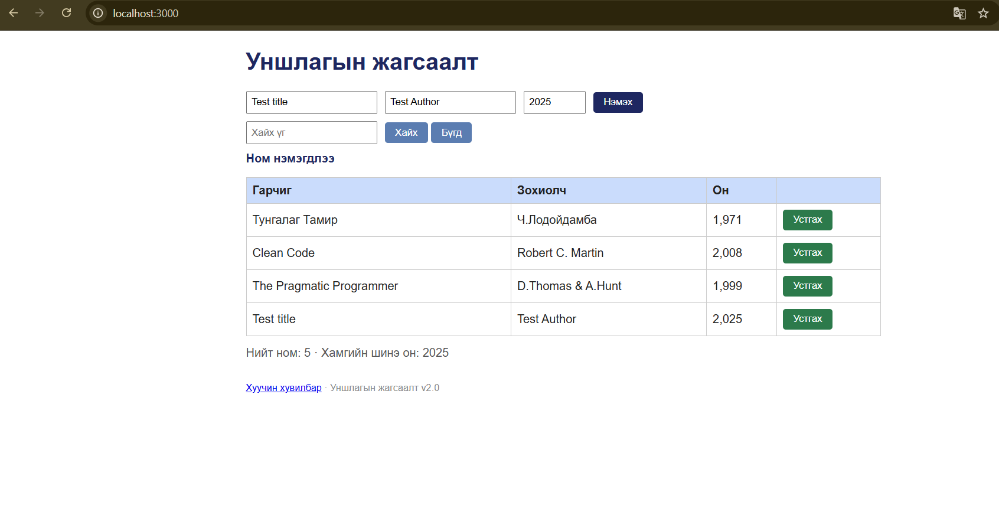
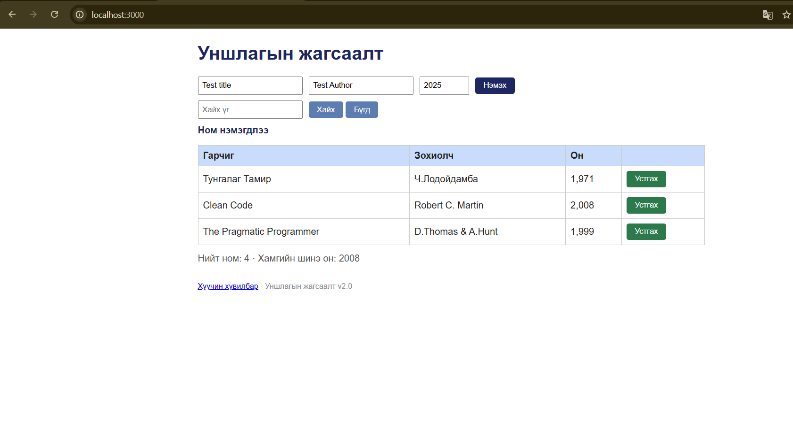

# BUG-01: Нийт номын тоолуур хүснэгт дэх номын тоотой зөрж байна

**Орчин:** Уншлагын жагсаалт v2.0, Google Chrome 155.0.8059.84 (64-bit), Ubuntu Linux (WSL2), Node.js v22.22.1, 2026-10-18

**Урьдчилсан нөхцөл:** `node app.js`-ийг шинээр асаасан, анхны 3 номтой төлөв.

## Дахин гаргах алхам

1. Терминал дээр `node app.js` командаар аппыг ажиллуулна.
2. Браузераар `http://localhost:3000` хаягийг нээнэ.
3. Хүснэгт дэх номын мөрүүдийг тоолно.
4. Хүснэгтийн доорх `Нийт ном` тоолууртай харьцуулна.
5. Гарчиг `Test title`, зохиолч `Test Author`, он `2025` гэсэн утгатай ном нэмнэ.
6. Хүснэгт дэх мөрийн тоо болон тоолуурыг дахин харьцуулна.
7. Нэмсэн номыг устгаад тоолуурыг дахин шалгана.

## Хүлээгдэж байсан

`Нийт ном` тоолуур хүснэгтэд байгаа номын тоотой тэнцүү байна. Ном нэмэхэд нэгээр нэмэгдэж, ном устгахад нэгээр буурна.

## Бодит үр дүн

Апп шинээр асахад хүснэгтэд 3 ном байсан боловч `Нийт ном: 4` гэж харагдсан. Нэг ном нэмэхэд хүснэгтэд 4 ном болж, тоолуур 5 болсон. Нэмсэн номыг устгасны дараа хүснэгтэд 3 ном үлдсэн ч тоолуур 4 гэж харагдсан.

## Ноцтой байдал

**Major** — жагсаалтын бодит өгөгдлийн тоо буруу харагдаж, хэрэглэгчийг төөрөгдүүлнэ.

## Хавсралт

### 1. Анхны төлөв

### 2. Ном нэмсний дараа

### 3. Ном устгасны дараа

**Олдсон аялал:** Supermodel (GUI), хүснэгтийн тоолуур шалгах