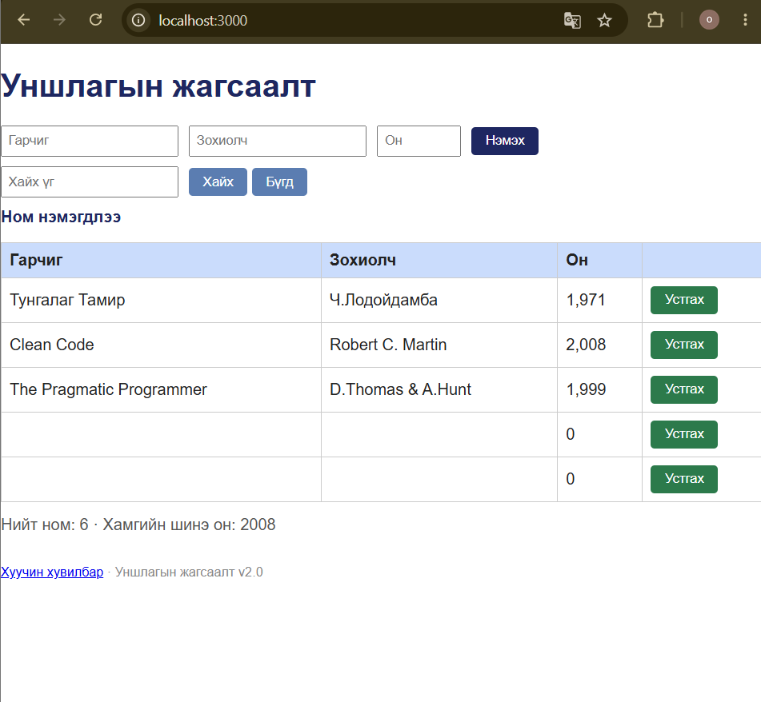

# BUG-02: Бүх талбар хоосон үед ном нэмэгдэж байна

**Орчин:** Уншлагын жагсаалт v2.0, Google Chrome 155.0.8059.84 (64-bit), Ubuntu Linux (WSL2), Node.js v22.22.1, 2026-10-18

**Урьдчилсан нөхцөл:** `node app.js`-ийг шинээр асаасан, анхны 3 номтой төлөв.

## Дахин гаргах алхам

1. Терминал дээр `node app.js` командаар аппыг ажиллуулна.
2. Браузераар `http://localhost:3000` хаягийг нээнэ.
3. Гарчиг, Зохиолч, Он гэсэн гурван талбарыг хоосон үлдээнэ.
4. `Нэмэх` товчийг дарна.
5. Хүснэгтэд хоосон мөр нэмэгдсэн эсэх болон мессежийг шалгана.

## Хүлээгдэж байсан

Гарчиг, зохиолч, он гурван талбар бүгд заавал бөглөгдсөн байна. Аль нэг талбар хоосон бол ном нэмэгдэхгүй бөгөөд ойлгомжтой алдааны мессеж гарна.

## Бодит үр дүн

Гурван талбарыг хоосон орхин `Нэмэх` товчийг дарахад `Ном нэмэгдлээ` гэсэн мессеж гарч, хоосон номын мөр нэмэгдсэн. Үйлдлийг давтан хийхэд дахин нэг хоосон мөр үүссэн.

## Ноцтой байдал

**Major** — хоосон өгөгдөл номын жагсаалтад бүртгэгдэж, мэдээллийн бүрэн бүтэн байдалд нөлөөлнө.

## Хавсралт

**Олдсон аялал:** Couch Potato (хоосон оролтын туршилт)
