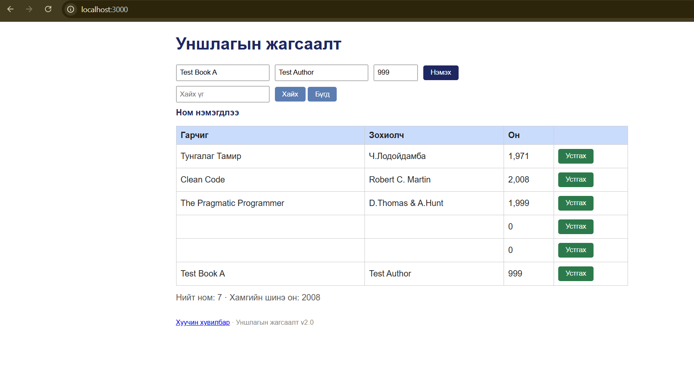
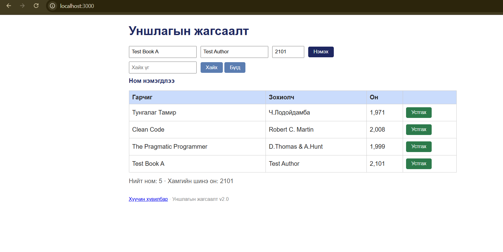

# BUG-03: Он талбар зөвшөөрөгдөх хязгаараас гадуурх утгыг хүлээн авч байна

**Орчин:** Уншлагын жагсаалт v2.0, Google Chrome 155.0.8059.84 (64-bit), Windows, 2026-10-18

**Урьдчилсан нөхцөл:** `node app.js`-ийг шинээр асаасан, анхны 3 номтой төлөв.

## Дахин гаргах алхам

1. `http://localhost:3000` хаягийг нээнэ.
2. Гарчиг талбарт `Test Book A` гэж оруулна.
3. Зохиолч талбарт `Test Author` гэж оруулна.
4. Он талбарт `999` гэж оруулаад `Нэмэх` товчийг дарна.
5. Аппыг зогсоож, `node app.js` командаар дахин асаана.
6. Дахин `Test Book A`, `Test Author` утгуудыг оруулж, он талбарт `2101` гэж бичээд `Нэмэх` товчийг дарна.

## Хүлээгдэж байсан

Он нь 1000–2100 хоорондох бүхэл тоо байх ёстой. Хязгаараас гадуурх утгатай ном нэмэгдэхгүй, ойлгомжтой алдааны мессеж гарна.

## Бодит үр дүн

`999` болон `2101` утгуудтай ном хоёулаа нэмэгдэж, `Ном нэмэгдлээ` гэсэн мессеж гарсан.

## Ноцтой байдал

**Major** — зөвшөөрөгдөхгүй өгөгдөл системд бүртгэгдэж, номын жагсаалт болон хамгийн шинэ оны мэдээлэлд нөлөөлж байна.

## Хавсралт

**Олдсон аялал:** Couch Potato (захын оролтын баталгаажуулалт)
