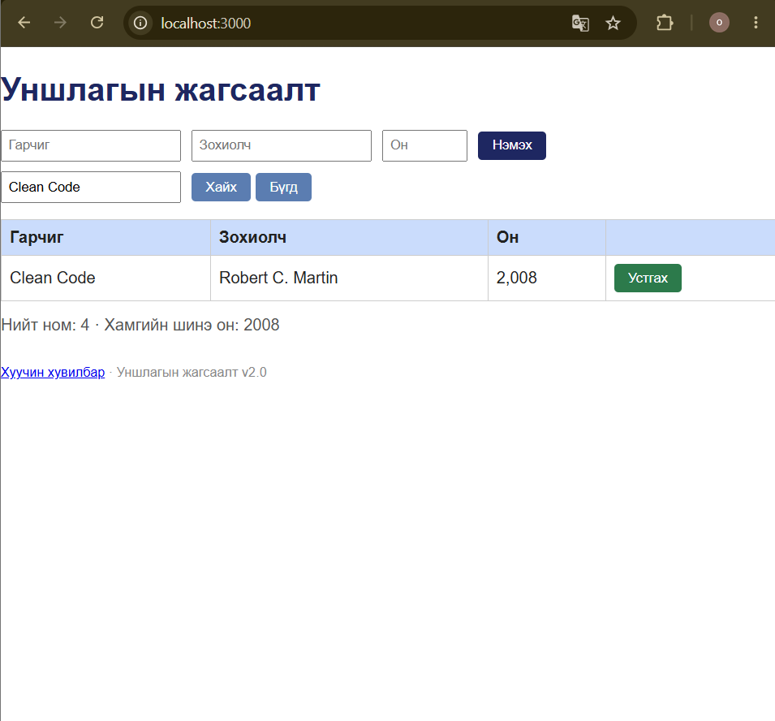
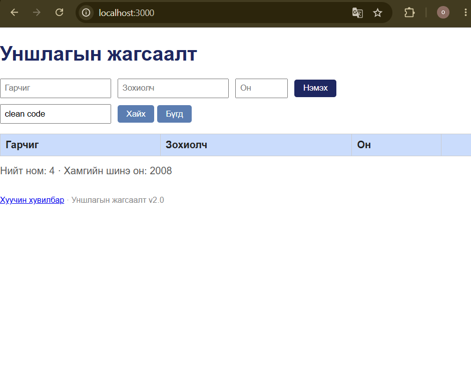
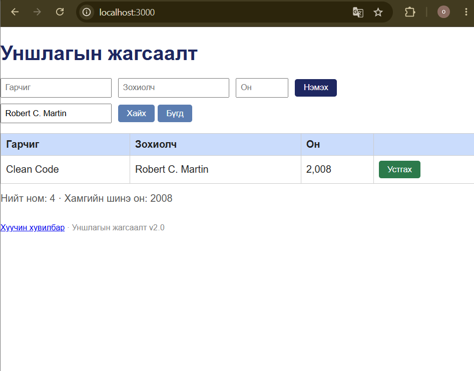
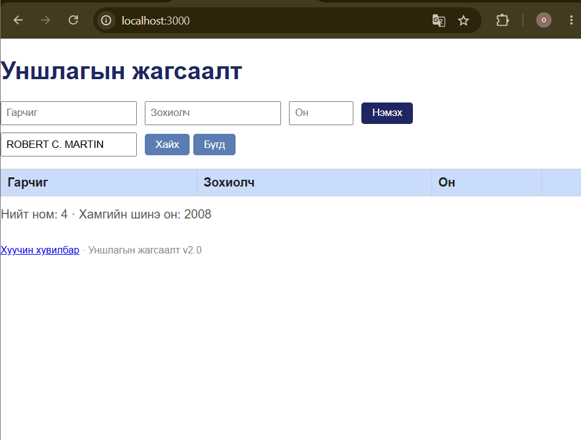

# BUG-04: Хайлт том, жижиг үсэг ялгаж байна

**Орчин:** Уншлагын жагсаалт v2.0, Google Chrome 155.0.8059.84 (64-bit), Windows, 2026-10-18

**Урьдчилсан нөхцөл:** `node app.js`-ийг шинээр асаасан, анхны 3 номтой төлөв.

## Дахин гаргах алхам

1. `http://localhost:3000` хаягийг нээнэ.
2. Хайлтын талбарт `Clean Code` гэж бичээд `Хайх` дарна.
3. `Clean Code` ном гарч ирснийг шалгана.
4. Хайлтын талбарт `clean code` гэж бичээд дахин `Хайх` дарна.
5. Хайлтын талбарт `Robert C. Martin` гэж бичиж хайна.
6. Дараа нь `ROBERT C. MARTIN` гэж бичиж хайна.

## Хүлээгдэж байсан

Хайлт гарчиг болон зохиогчоос том, жижиг үсэг ялгахгүйгээр хайх ёстой.

## Бодит үр дүн

`Clean Code` болон `Robert C. Martin` хайлтаар ном олдсон. Харин `clean code` болон `ROBERT C. MARTIN` хайлтаар ижил ном олдоогүй.

## Ноцтой байдал

**Major** — хэрэглэгч зөвхөн үсгийн том, жижиг хэлбэрийг өөрчилснөөс болж байгаа номоо олж чадахгүй байна.

## Хавсралт

**Гарчгийн хайлт**

**Зохиогчийн хайлт**

**Олдсон аялал:** Supermodel (GUI), хайлтын туршилт
