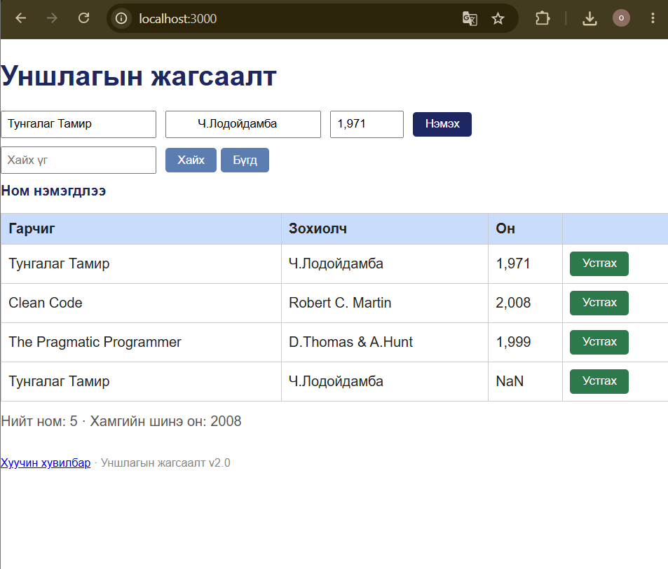

# BUG-06: Ижил гарчиг, зохиолчтой номыг давхар нэмэх боломжтой

**Орчин:** Уншлагын жагсаалт v2.0, Google Chrome 155.0.8059.84 (64-bit), Windows, 2026-10-18

**Урьдчилсан нөхцөл:** `node app.js`-ийг шинээр асаасан, анхны 3 номтой төлөв.

## Дахин гаргах алхам

1. `http://localhost:3000` хаягийг нээнэ.
2. Гарчиг талбарт `Тунгалаг Тамир` гэж оруулна.
3. Зохиолч талбарт `Ч.Лодойдамба` гэж оруулна.
4. Он талбарт `1971` гэж оруулна.
5. `Нэмэх` товчийг дарна.
6. Хүснэгтэд ижил гарчиг, зохиолчтой хоёр мөр байгаа эсэхийг шалгана.

## Хүлээгдэж байсан

Ижил гарчиг, зохиолчтой ном давхар нэмэгдэх ёсгүй. Апп давхардлыг хориглох эсвэл ойлгомжтой мессеж харуулах ёстой.

## Бодит үр дүн

Ижил гарчиг, зохиолчтой ном дахин нэмэгдэж, хүснэгтэд давхардсан мөр үүссэн.

## Ноцтой байдал

**Major** — номын бүртгэл давхардаж, жагсаалтын өгөгдлийн үнэн зөв байдал алдагдана.

## Хавсралт

**Олдсон аялал:** Supermodel (GUI), өгөгдөл нэмэх урсгал

