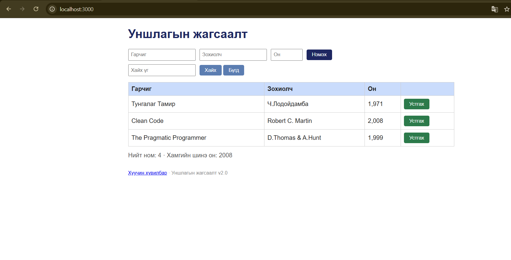

# BUG-07: Устгах товч аюултай үйлдлийг илэрхийлэх улаан өнгөтэй биш байна

**Орчин:** Уншлагын жагсаалт v2.0, Google Chrome 155.0.8059.84 (64-bit), Ubuntu Linux (WSL2), 2026-10-18

**Урьдчилсан нөхцөл:** `node app.js`-ийг шинээр асаасан, анхны 3 номтой төлөв.

## Дахин гаргах алхам

1. `node app.js` командаар аппыг ажиллуулна.
2. Браузераар `http://localhost:3000` хаягийг нээнэ.
3. Хүснэгтийн ном бүрийн `Устгах` товчны өнгийг ажиглана.

## Хүлээгдэж байсан

Спецификацийн дагуу аюултай үйлдлийн `Устгах` товч улаан өнгөтэй байна.

## Бодит үр дүн

`Устгах` товчнууд ногоон өнгөтэй харагдаж байна.

## Ноцтой байдал

**Minor** — устгах үйлдэл ажиллаж болох ч аюултай үйлдлийг өнгөөр ялгах интерфейсийн шаардлага хангагдаагүй.

## Хавсралт

**Олдсон аялал:** Supermodel (GUI)

