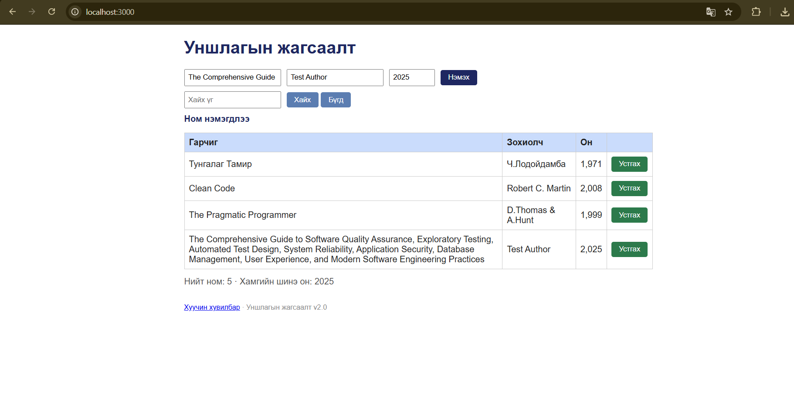

# Session report

**Тестер:** Т.Оюунжаргал

**Огноо:** 2026-10-18, 00:42–01:42 (60 минут)

**Mission:** Уншлагын жагсаалт аппын чанарыг шинжлэх

**Charter:** Supermodel (GUI), Couch Potato (хоосон болон захын оролт), Saboteur (API түвшний довтолгоо) аяллаар ном нэмэх, хайлт, хүснэгтийн тоолуур, өгөгдлийн баталгаажуулалт болон API-ийн зан төлөвийг шалгав.

## Тэмдэглэл (он цагийн дарааллаар)

> Тайлбар: Доорх минутууд нь тестийн үйл явдлыг дараалалд оруулах ойролцоо цагууд бөгөөд бодит цагийн тэмдэглэл биш.

- 00:42 — Аппыг `http://localhost:3000` хаягаар нээж, анхны дэлгэц болон 3 номын жагсаалтыг шалгав. «Нийт ном: 4» гэж харагдсан тул хүснэгтийн мөрийн тоотой зөрүүг тэмдэглэв. BUG-01.
- 00:46 — Гарчиг, зохиолч, он талбаруудыг хоосон орхин «Нэмэх» товчийг хоёр удаа дарав. Хоёр хоосон ном нэмэгдэж, «Ном нэмэгдлээ» гэсэн мессеж гарсан. BUG-02.
- 00:52 — `999` гэсэн онтой ном нэмэхэд систем зөвшөөрөв. BUG-03.
- 00:57 — Аппыг дахин асааж, `2101` гэсэн онтой ном нэмэхэд мөн зөвшөөрөв. BUG-03.
- 01:03 — `Clean Code` болон `clean code` хайлтын үр дүнг харьцуулав. Том үсгээр бичсэн хувилбар үр дүн өгч, жижиг үсгээр бичсэн хувилбар үр дүн өгөөгүй. BUG-04.
- 01:08 — `Robert C. Martin` болон `ROBERT C. MARTIN` хайлтын үр дүнг харьцуулав. Том, жижиг үсгийн ялгаанаас шалтгаалан үр дүн өөрчлөгдөв. BUG-04.
- 01:14 — Буруу JSON биетэй `POST /api/books` хүсэлтийг `curl -i` ашиглан илгээв. Сервер `HTTP/1.1 200 OK` болон `{"result":"OK"}` буцаасан. BUG-05.
- 01:20 — Ижил гарчиг, зохиолчтой `Тунгалаг Тамир` номыг дахин нэмэхэд давхардсан мөр үүсэв. BUG-06.
- 01:27 — Урт гарчигтай ном нэмэв. Гарчиг хүснэгтийн нүдэнд олон мөрөөр харагдсан; энэ туршилтаар хүснэгтийн эвдрэл ажиглагдсангүй. 
- 01:33 — «Устгах» товчнуудын өнгийг шалгав. Товчнууд ногоон байсан нь спецификацийн улаан өнгийн шаардлагатай зөрөв. BUG-07.
- 01:38 — Ном нэмэх, устгах үйлдлийн өмнөх ба дараах тоолуурыг харьцуулав. Хүснэгтэд 3 ном байхад тоолуур 4, 4 ном байхад 5 гэж харагдсан. BUG-01.
- 01:42 — Session-ийг дуусгаж, илэрсэн согогуудын нотолгоо, screenshot болон API гаралтыг нэгтгэхээр тэмдэглэв.

## Саадууд (issues)

- Туршилтын явцад тэмдэглэл бүрийн яг цагийг тусад нь бүртгээгүй тул дээрх минутуудыг дарааллыг харуулах ойролцоо цаг гэж үзнэ.
- Аппын өгөгдөл санах ойд хадгалагддаг тул туршилтын хооронд серверийг дахин асааж анхны төлөвийг сэргээх шаардлагатай байв.

## Цагийн задаргаа

- Setup: 10%
- Тест дизайн ба гүйцэтгэл: 65%
- Согог судлах, нотолгоо бүрдүүлэх: 25%